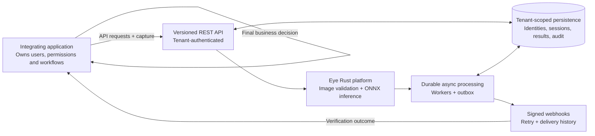

# King Sparkon Eye

**An integration-agnostic identity verification platform for face-based verification.**

King Sparkon Eye (Eye) is a Rust service and platform foundation for applications that need face-only identity verification through versioned APIs. A tenant owns its identities and scopes; an integrating application owns its customers, employees, tickets, events, orders, permissions, and business workflows. Eye returns a probabilistic verification result. It does not decide whether a person is entitled to a service or action.

> **Implementation status — 6 November 2026:** The repository contains a working Axum service, account/authentication routes, bounded image ingress, and a YuNet/ONNX face-detection assessment path. The standalone multi-tenant identity API described below is the approved product direction, not a shipped end-to-end capability. Tenant isolation, identity lifecycle, 1:1 matching, scoped 1:N identification, durable asynchronous verification sessions, and signed webhooks remain implementation work tracked by [epic #181](https://github.com/leonard1thecoder/king-sparkon-eye/issues/181) and [issues #182–#192](https://github.com/leonard1thecoder/king-sparkon-eye/issues/182).

## Security authorization status

Public account creation and Google sign-in must not be treated as permission approval. The password-registration privilege escalation is tracked in [#226](https://github.com/leonard1thecoder/king-sparkon-eye/issues/226); its fix is not merged or deployed yet. The related Google OAuth issue is [#132](https://github.com/leonard1thecoder/king-sparkon-eye/issues/132), with a forward-only mitigation in PR #223 that also requires applying its database migration. Until these fixes are merged and deployed, do not expose the current registration/OAuth paths as a trusted biometric-enrollment authorization flow.

## Product boundary

Eye is designed to provide reusable identity-verification primitives to unrelated applications.

### Eye owns

- Tenant-scoped identity references and identity lifecycle.
- Face enrollment and protected biometric templates, subject to approved authorization and consent controls.
- Face-only verification and identification.
- **1:1 match:** compare a capture against one specified identity owned by the authenticated tenant.
- **Scoped 1:N identify:** search only within an explicit identity scope owned by that tenant.
- Image validation, face detection, inference and verification outcomes.
- Asynchronous verification sessions, durable processing, result retrieval and signed webhook delivery as those workstreams are implemented.
- Tenant-scoped credentials, policies, evidence references, audit, retention and deletion controls as those workstreams are implemented.

### The integrating application owns

- Its users, customers, employees, attendees, recipients, tickets, events, deliveries, orders and other business entities.
- Its authorization rules, permissions, purpose selection and scope membership decisions.
- Consent capture and its lawful-processing responsibilities, subject to the agreed API contract and applicable law.
- The final business decision after receiving Eye's probabilistic result.

An identity scope is a search boundary, not an Eye-owned event, ticket, employee or customer workflow. No tenant may search another tenant's identities, templates, evidence or candidate set. There is no global face search.

## Architecture

The following is the **target platform architecture**. It is not a claim that every component is currently wired or production-ready.



Logical modules do not require separate microservice deployments. The platform is intended to expose versioned REST/JSON APIs, multipart capture upload, asynchronous status/result retrieval, and signed webhooks. The integrating application remains authoritative for its own business decisions.

## Capability and implementation status

The distinction below is deliberate: a proposed API or repository abstraction is not a shipped end-to-end feature.

| Capability | Current status | Evidence / limitation |
|---|---|---|
| Rust HTTP service and health probes | **Implemented** | Axum router; `GET /health/live` and `GET /health/ready`. |
| Public landing and account pages | **Implemented** | Axum-served pages at `/` and `/auth/*`; see [public-page brief](docs/PUBLIC-LANDING-PAGE.md). |
| Email/password account flows | **Implemented, integration limits remain** | Registration, login, password-reset request and confirmation routes exist. |
| Google OAuth | **Partial** | Rust-owned Google flow and exchange routes exist; verify deployment configuration and outstanding authorization/storage issues before relying on it. |
| Authenticated photo assessment | **Implemented, synchronous** | `POST /v1/enrollment/photo-assessments` accepts multipart input and requires a bearer token with `enrollment:write`. It returns an assessment only. |
| Image validation and bounded ingress | **Partial** | JPEG/static PNG decode and configured request/image limits exist. The exact image-part cap is still checked after the bounded request body is buffered; see [#124](https://github.com/leonard1thecoder/king-sparkon-eye/issues/124). |
| ONNX face detection | **Implemented** | Vendored YuNet model runs through ONNX Runtime on Linux x86_64 CPU. |
| Photo-quality assessment | **Partial / not calibrated** | Deterministic checks exist, but nominal passes are conservatively downgraded to `ASSESSMENT_UNAVAILABLE` pending consented evaluation and threshold calibration. |
| Face embeddings and 1:1 matching | **Not implemented** | SFace is a documented target contract; weights/adapter and evaluation are not complete. |
| Scoped 1:N identification | **Not implemented** | Legacy gate-identification contracts are not a live platform API. No global search exists. |
| Tenant isolation and tenant API credentials | **Planned** | Tracked by [#183](https://github.com/leonard1thecoder/king-sparkon-eye/issues/183) and [#184](https://github.com/leonard1thecoder/king-sparkon-eye/issues/184). Current account authentication is not a completed tenant machine-credential system. |
| Identity registry and enrollment lifecycle | **Planned** | [#185](https://github.com/leonard1thecoder/king-sparkon-eye/issues/185). The current photo-assessment route does not enroll or persist an identity. |
| Generic scopes and verification-session API | **Planned** | [#186](https://github.com/leonard1thecoder/king-sparkon-eye/issues/186). |
| Durable asynchronous verification jobs | **Planned** | [#187](https://github.com/leonard1thecoder/king-sparkon-eye/issues/187). Existing outbox persistence primitives are not an async verification worker runtime. |
| Signed webhooks | **Planned** | [#188](https://github.com/leonard1thecoder/king-sparkon-eye/issues/188). |
| Evidence, audit, retention and deletion | **Partial foundation / planned platform controls** | Existing storage abstractions are not the complete tenant-scoped lifecycle in [#189](https://github.com/leonard1thecoder/king-sparkon-eye/issues/189). |
| TypeScript SDK and conformance suite | **Planned** | [#190](https://github.com/leonard1thecoder/king-sparkon-eye/issues/190). |
| Developer console and platform website | **Separate implementation issue** | [#191](https://github.com/leonard1thecoder/king-sparkon-eye/issues/191). Current landing/auth pages are not the developer console. |
| Technical SEO | **Partial** | [#192](https://github.com/leonard1thecoder/king-sparkon-eye/issues/192): homepage metadata, canonical/social tags, WebSite JSON-LD, robots, sitemap and non-indexable route headers are implemented in the issue branch. Expanded public docs pages and measured performance baselines remain outstanding. |

### Important security and readiness blockers

- [#132 — Google sign-in privilege escalation](https://github.com/leonard1thecoder/king-sparkon-eye/issues/132) is open. Verified Google sign-in currently grants `enrollment:write` to new verified accounts; do not interpret sign-in as tenant authorization or production enrollment approval.
- [#95 — no consented real-face data or calibrated thresholds](https://github.com/leonard1thecoder/king-sparkon-eye/issues/95) remains open. Synthetic inputs do not establish real-world accuracy, false-acceptance rates, false-rejection rates or safe operating thresholds.
- [#124 — incremental multipart image-part limits](https://github.com/leonard1thecoder/king-sparkon-eye/issues/124) remains open.
- [#28 — Kafka producer and delivery](https://github.com/leonard1thecoder/king-sparkon-eye/issues/28) remains open. The SQLx outbox repository work in [#113](https://github.com/leonard1thecoder/king-sparkon-eye/issues/113) does not by itself deliver Kafka messages.
- [#112 — durable OAuth identity and transaction storage](https://github.com/leonard1thecoder/king-sparkon-eye/issues/112) remains open; the SQLx persistence layer exists, but OAuth route consolidation and remaining acceptance criteria must be checked.
- No claim is made here that the platform is production-ready, legally compliant, liveness-capable, or accurate to a particular percentage.

## ONNX and AI inference

Computer vision is a core part of Eye, not an optional CRUD extension.

### Implemented detector

The current photo-assessment route loads the vendored **YuNet 2023mar** face detector:

- Artifact: `artifacts/models/yunet-2023mar/face_detection_yunet_2023mar.onnx`.
- Runtime: ONNX Runtime **1.31.1**, Linux x86_64 CPU execution provider.
- Input: `input`, FP32 tensor with fixed shape `[1, 3, 640, 640]`.
- Output groups: classification, objectness, bounding-box offsets and five facial landmarks.
- Preprocessing: BGR channel order and letterboxing to 640×640.
- The model and runtime are vendored and recorded in [artifacts/manifest.json](artifacts/manifest.json); build/test does not download model weights.

YuNet detects faces and landmarks. It does **not** identify a person, establish liveness, prove legal identity, or authorize a business action.

### Recognition model status

The repository documents an intended **SFace 2021dec** recognition contract: aligned 112×112 input and a 128-dimensional normalized embedding, compared with cosine similarity. This is a target specification, not an implemented recognition capability: the recognition weights/adapter and evaluation gates are not complete. See [ONNX model contract inventory](docs/ONNX_MODEL_CONTRACT_INVENTORY.md) and [#61 — evaluation and threshold calibration](https://github.com/leonard1thecoder/king-sparkon-eye/issues/61).

The optional Meta Muse Spark adapter is supplementary visual-quality guidance only. The current photo-assessment route supplies a disabled provider; it does not call the provider. No frontier model can override deterministic ingress, face-detection or suitability decisions.

## Current HTTP surface

These are the relevant routes mounted by the current Rust service. They are not the proposed standalone identity API.

| Method | Path | Current behavior |
|---|---|---|
| GET | `/` | Public product landing page. |
| GET | `/robots.txt` | Public crawler policy and sitemap discovery. |
| GET | `/sitemap.xml` | XML sitemap containing only the canonical public homepage. |
| GET | `/health/live` | Process liveness response. |
| GET | `/health/ready` | Readiness and dependency status. |
| POST | `/v1/enrollment/photo-assessments` | Authenticated, synchronous photo assessment; no identity enrollment or persistence. |
| POST | `/v1/auth/register` | Account registration. |
| POST | `/v1/auth/login` | Password login and token issuance. |
| POST | `/v1/auth/refresh` | Refresh-token rotation. |
| GET | `/v1/auth/google/start` | Start Google OAuth. |
| GET | `/v1/auth/google/callback` | Handle Google provider callback. |
| POST | `/v1/auth/oauth/exchange` | Exchange a one-time Eye handoff code. |
| POST | `/v1/auth/password-reset/request` | Request a password-reset email. |
| POST | `/v1/auth/password-reset/confirm` | Confirm a password reset. |
| GET | `/auth/sign-in`, `/auth/register`, `/auth/forgot-password`, `/auth/reset-password`, `/auth/callback` | Browser account pages. |

The current photo-assessment response is synchronous and includes an assessment identifier, request identifier, suitability, reason codes, persistence status, model version and policy version. It reports `persistence: NOT_REQUESTED`; it does not create an identity, save a face template, create an asynchronous verification session, or publish a result event.

The existing [OpenAPI document](openapi/eye.openapi.json) describes the earlier photo-assessment / gate-identification contract. It is **not yet the canonical contract for the new standalone platform**. The architecture and API contract work is tracked by [#182](https://github.com/leonard1thecoder/king-sparkon-eye/issues/182) and [#186](https://github.com/leonard1thecoder/king-sparkon-eye/issues/186). Until that contract is implemented and verified, this README intentionally does not provide a working identity-verification quick start or invent request/response examples.


## Public-site SEO baseline

The GitHub repository homepage setting identifies the intended production origin as https://king-sparkon-eye.vercel.app. src/seo.rs is the source of truth for that origin and the crawl-control endpoints.

- The / route is currently the **only** public, indexable route. It is server-rendered as static HTML by Axum and is the only URL in /sitemap.xml.
- /robots.txt allows public content and disallows /auth/, /v1/, /health/, and reserved private route classes such as /console/, /account/, /sessions/, /tenants/ and /verification/.
- Account pages declare noindex,nofollow,noarchive; account, health and API route responses also send X-Robots-Tag: noindex, nofollow, noarchive.
- The homepage has a unique title and description, an absolute canonical URL, Open Graph and Twitter/X metadata, a dedicated same-origin SVG favicon with the existing GIF logo as fallback, and a minimal WebSite JSON-LD object. Structured data intentionally contains no fabricated legal entity details, pricing, ratings, customers or availability.
- The sitemap intentionally excludes authentication, health and API routes. It also excludes /api, /privacy, /terms, /consent, developer-console and session pages because those public product pages are not currently mounted. Do not add a route to the sitemap until it exists, is public, has crawlable content and has its own canonical metadata. The broader website/console work is tracked in [#191](https://github.com/leonard1thecoder/king-sparkon-eye/issues/191), and the legacy public-pages issue is [#35](https://github.com/leonard1thecoder/king-sparkon-eye/issues/35).
- The current API specification remains a legacy photo-assessment contract, not the canonical standalone identity API. The landing page links to implementation status rather than presenting that legacy OpenAPI document as the new platform contract.

### Search launch checklist

1. Verify ownership of https://king-sparkon-eye.vercel.app/ in Google Search Console and Bing Webmaster Tools using the provider's current verification flow.
2. Submit https://king-sparkon-eye.vercel.app/sitemap.xml after ownership is verified.
3. Inspect the homepage URL and rendered canonical/social metadata in each provider.
4. Check that /auth/*, /v1/* and /health/* are excluded from indexing; robots exclusions are crawl guidance, while noindex headers/meta are the indexing controls.
5. Re-submit the sitemap when additional public pages are implemented with their own canonical URLs.
6. Measure mobile and desktop Core Web Vitals on the deployed production site before launch and after material changes. **No field-data or Lighthouse baseline has been measured in this repository yet.** Do not claim a score or passing Core Web Vitals until a measurement is recorded.

The sitemap's single homepage entry is deliberate, not a placeholder for speculative routes. Search visibility for capabilities, API reference, security/privacy and contact pages depends on those real pages being delivered under #191/#35 and the canonical API contract work in #182/#186.

## Asynchronous lifecycle — target behavior

The approved platform contract separates processing state from verification outcome.

- Requests are accepted durably and processed asynchronously.
- A client can retrieve the current session state and final result.
- Signed webhooks notify a tenant-owned endpoint when an allowlisted event completes.
- Delivery is expected to be at-least-once; consumers deduplicate by stable event ID.
- Infrastructure failure, expiry and cancellation are processing states, not negative identity matches.
- A result such as `verified`, `not_verified`, `identified`, `no_candidate`, `ambiguous` or `inconclusive` is a probabilistic verification outcome, not business authorization.

These are target contract semantics from [#186](https://github.com/leonard1thecoder/king-sparkon-eye/issues/186), [#187](https://github.com/leonard1thecoder/king-sparkon-eye/issues/187) and [#188](https://github.com/leonard1thecoder/king-sparkon-eye/issues/188). They are not currently exposed as a complete runtime lifecycle.

## Tenant isolation, privacy and security

Tenant isolation is a non-negotiable design requirement, but the complete enforcement is still planned.

- Tenant context must be derived from validated credentials, never trusted from a request-supplied tenant ID or header.
- Identity, template, scope, session, result, evidence, webhook and audit access must be tenant-scoped.
- Cross-tenant references must fail without disclosing whether another tenant's resource exists.
- No global face search, cross-tenant template reuse or candidate enumeration is permitted.
- API credentials are intended to be tenant-bound, least-privilege, hashed at rest, expiring, rotatable and revocable.
- Biometric images, embeddings, templates, provider payloads, tokens and secrets must not be written to ordinary logs or events.
- Retention and deletion must be explicit, configurable and auditable. This README does not claim universal legal compliance or a specific retention period.

The integrating application supplies its consent reference and remains responsible for consent capture and lawful processing. An opaque reference alone is not proof that valid consent was obtained. See [threat model](docs/THREAT_MODEL.md), [consent and template design](docs/CONSENT_AND_TEMPLATE_DESIGN.md), and the open security/consent issues.

## Local development

### Prerequisites

- Rust **1.97.0** with `rustfmt` and `clippy` components (see [rust-toolchain.toml](rust-toolchain.toml)).
- Cargo and a supported native build environment.
- The vendored ONNX Runtime/model artifacts under `artifacts/`; no model download is required.

### Run the service

```bash
cargo run
```

By default the service listens on `0.0.0.0:8080`.

```bash
curl -i http://127.0.0.1:8080/health/live
curl -i http://127.0.0.1:8080/health/ready
```

### Configuration

All settings are optional for the basic local service. Defaults and validation are defined in `src/config/mod.rs`.

| Variable | Default | Purpose |
|---|---|---|
| `EYE_BIND_ADDR` | `0.0.0.0:8080` | Bind address; takes precedence over `PORT`. |
| `PORT` | unset | Hosting-platform port fallback when `EYE_BIND_ADDR` is unset. |
| `EYE_LOG_FILTER` | `info` | Rust tracing filter. |
| `EYE_UPLOAD_MAX_BYTES` | `10485760` | Maximum image bytes (10 MiB). |
| `EYE_IMAGE_MAX_WIDTH` | `4096` | Maximum decoded image width. |
| `EYE_IMAGE_MAX_HEIGHT` | `4096` | Maximum decoded image height. |
| `EYE_IMAGE_MAX_PIXELS` | `16777216` | Maximum decoded pixel count. |
| `EYE_IMAGE_MAX_DECODE_ALLOC_BYTES` | `268435456` | Maximum decoder allocation (256 MiB). |
| `EYE_IMAGE_DECODE_TIMEOUT_MS` | `5000` | Image decode timeout. |
| `EYE_YUNET_MODEL_PATH` | vendored YuNet path | Optional override for the YuNet ONNX model. |
| `ORT_DYLIB_PATH` | vendored ONNX Runtime path | Optional override for the ONNX Runtime shared library. |

The optional vision-provider settings are `EYE_VISION_PROVIDER_ENABLED`, `EYE_VISION_PROVIDER_API_KEY`, `EYE_VISION_PROVIDER_BASE_URL`, `EYE_VISION_PROVIDER_MODEL`, `EYE_VISION_PROVIDER_TIMEOUT_MS`, `EYE_VISION_PROVIDER_MAX_RESPONSE_BYTES` and `EYE_VISION_PROVIDER_MAX_RETRIES`. The provider is disabled by default and is not called by the current photo-assessment route.

Google OAuth requires the complete server-side configuration group: `EYE_GOOGLE_CLIENT_ID`, `EYE_GOOGLE_CLIENT_SECRET`, `EYE_GOOGLE_REDIRECT_URL`, `EYE_DATABASE_REST_URL`, `EYE_DATABASE_SERVICE_ROLE_KEY`, `EYE_OAUTH_CALLBACK_URLS`, `EYE_OAUTH_EXCHANGE_SECRET` and `EYE_JWT_SIGNING_SECRET`. Optional settings include `EYE_JWT_KID` and `EYE_OAUTH_ALLOW_LOCALHOST_HTTP` (local development only). Never expose database service-role keys, exchange secrets or JWT signing secrets to browser code or commit them to the repository. OAuth is disabled unless its required configuration is complete.

### Tests and checks

Run the same Rust checks used by CI:

```bash
cargo fmt --all --check
cargo clippy --all-targets --all-features -- -D warnings
cargo test --all-features --locked
python3 tests/test_stripe_catalog_provisioning.py
```

PostgreSQL-backed persistence tests require a test database when the relevant test configuration is enabled. A test suite that skips database-backed tests is not evidence that those database paths passed against PostgreSQL.

## Repository map

| Path | Purpose |
|---|---|
| `src/api/` | Axum routes, middleware and HTTP handlers. |
| `src/auth/` | Account, password, JWT, Google OAuth and browser auth pages. |
| `src/ingress/` | Bounded upload handling and safe image decoding. |
| `src/inference/` | Face detector interfaces and YuNet ONNX adapter. |
| `src/quality/` | Deterministic image-quality measurements. |
| `src/domain/` | Assessment orchestration and event-domain primitives. |
| `src/provider/` and `src/advisory/` | Optional frontier-vision adapter and constrained guidance. |
| `src/storage/` | Object-store abstraction and enrollment metadata foundation. |
| `src/persistence/` and `migrations/` | SQLx/PostgreSQL persistence primitives and migrations. |
| `src/contract/` and `openapi/` | Existing DTOs, errors and legacy OpenAPI contract. |
| `src/config/` | Environment configuration and validation. |
| `artifacts/` | Vendored YuNet model and ONNX Runtime with manifest/licences. |
| `tests/` | Unit, integration, API, persistence and artifact tests. |
| `docs/` | Architecture, model, security, integration and implementation notes. |

## Roadmap

The standalone platform is tracked by [epic #181](https://github.com/leonard1thecoder/king-sparkon-eye/issues/181). The issue sequence is:

1. [#182 — architecture and API design rules](https://github.com/leonard1thecoder/king-sparkon-eye/issues/182)
2. [#183 — tenant-isolated persistence](https://github.com/leonard1thecoder/king-sparkon-eye/issues/183)
3. [#184 — tenant-bound API clients and permissions](https://github.com/leonard1thecoder/king-sparkon-eye/issues/184)
4. [#185 — identity registry and face enrollment](https://github.com/leonard1thecoder/king-sparkon-eye/issues/185)
5. [#186 — identity scopes and verification-session API](https://github.com/leonard1thecoder/king-sparkon-eye/issues/186)
6. [#187 — durable asynchronous jobs and result finalization](https://github.com/leonard1thecoder/king-sparkon-eye/issues/187)
7. [#188 — signed webhooks](https://github.com/leonard1thecoder/king-sparkon-eye/issues/188)
8. [#189 — evidence, audit, retention and deletion](https://github.com/leonard1thecoder/king-sparkon-eye/issues/189)
9. [#190 — TypeScript SDK and conformance suite](https://github.com/leonard1thecoder/king-sparkon-eye/issues/190)
10. [#191 — public website and developer console](https://github.com/leonard1thecoder/king-sparkon-eye/issues/191)
11. [#192 — technical SEO](https://github.com/leonard1thecoder/king-sparkon-eye/issues/192)

Existing work such as [#3](https://github.com/leonard1thecoder/king-sparkon-eye/issues/3), [#11](https://github.com/leonard1thecoder/king-sparkon-eye/issues/11), [#28](https://github.com/leonard1thecoder/king-sparkon-eye/issues/28), [#30](https://github.com/leonard1thecoder/king-sparkon-eye/issues/30), [#31](https://github.com/leonard1thecoder/king-sparkon-eye/issues/31), [#41](https://github.com/leonard1thecoder/king-sparkon-eye/issues/41), [#61](https://github.com/leonard1thecoder/king-sparkon-eye/issues/61), [#95](https://github.com/leonard1thecoder/king-sparkon-eye/issues/95), [#112](https://github.com/leonard1thecoder/king-sparkon-eye/issues/112), [#113](https://github.com/leonard1thecoder/king-sparkon-eye/issues/113), [#124](https://github.com/leonard1thecoder/king-sparkon-eye/issues/124) and [#132](https://github.com/leonard1thecoder/king-sparkon-eye/issues/132) must be reconciled rather than duplicated.

## Documentation

- [Implementation playbook](docs/IMPLEMENTATION-PLAYBOOK.md)
- [ONNX model contract inventory](docs/ONNX_MODEL_CONTRACT_INVENTORY.md)
- [Authentication boundary contracts](docs/AUTH_BOUNDARY_CONTRACTS.md)
- [Consent and template design](docs/CONSENT_AND_TEMPLATE_DESIGN.md)
- [Threat model](docs/THREAT_MODEL.md)
- [Public landing-page brief](docs/PUBLIC-LANDING-PAGE.md)
- [Billing plan domain](docs/BILLING_PLAN_DOMAIN.md)
- [Vendored model/runtime manifest](artifacts/manifest.json)
- [Existing OpenAPI document](openapi/eye.openapi.json) — legacy contract pending generalization for the standalone platform.

## Product and security principles

- Face similarity is probabilistic. It is not proof of legal identity, liveness, consent, or business authorization.
- 1:1 matching and scoped 1:N identification are separate operations with explicit target/scope boundaries.
- Tenant isolation is mandatory; cross-tenant identity lookup and global face search are prohibited.
- Asynchronous processing is the target default. The current photo-assessment endpoint remains synchronous until #186 and #187 are implemented.
- The integrating application owns business workflows and the final decision.
- Do not claim capabilities, model accuracy, security controls, production readiness or API behavior that code, tests and approved contracts do not verify.
